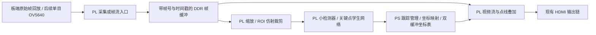

# Zynq-7020 独立实时关键点：网络与视频流水线

2026-10-26制定，10-27状态更新。属于 [总体方案](01_PYNQ-Z2移植与视频手势识别总体方案.md) 的关键点专题。
状态：工作量预算与96/128结构检查完成，教师导出、固定来源划分和浮点试训已跑通；
17项人工复核已导入，96/128经画外点掩码后复训，定位仍未过门禁，候选HLS尚未验收，
见[当前学生结果](../../project/analysis/keypoints_student_20261027/README.md)。
板内720p raw短循环实测约24次写入/秒、120秒无错过时隙；屏幕目视、VSync与端到端帧龄尚未验收，
见[视频实测](../../project/analysis/keypoints_pl_20261026/raw_video.md)。
已有可运行固件仍是 [0.49 秒/ROI 基线](../../project/analysis/keypoints_pl_20261026/stream_wide.md)。

## 1. 验收目标与范围

- 视觉线脱离 PC：视频输入、手部发现、关键点回归、叠加与 HDMI 输出在同一块板上完成。
- 先实现单手，再验收双手。双手各 20 次/秒意味着 **40 ROI/秒**，不是总计 20 ROI/秒。
- 第一门槛为每秒至少 20 张不同、带同期关键点的叠加画面；进一步争取 30 张。HDMI 60Hz 扫描不计作 60 次新结果。
- 初始采集 640×480、目标 30fps；已知 HDMI 模式为 1280×720，640×480 输出须另验显示器兼容。
- 稳态源帧起始时间戳到对应叠加画面提交的 P95 目标 ≤100ms。物理屏显时延另用拍屏/LED 方法验证，不能用 Python 返回时刻替代。
- 冷启动、首次找手、遮挡重检出分开计时；重检出目标 ≤250ms。所有数值是设计目标，尚未实测达标。
- 原项目身体＋双手需求保留；本预算只含双手。身体网络另设预算，不宣称当前候选已覆盖身体或词义。

## 2. 为什么需要换网络

旧图：224×224，49 个学习层，**145,562,816 MAC/ROI**、957,152 个 kernel 值，W12/A16。
实际前向中位数约 490ms；视频叠加通过整张 720p JPEG/SSH 往返，另有显示瓶颈。
旧图用于数值参照与蒸馏教师；其逐值一致结论不能继承到新模型。

候选结构：RGB → 3×3 stride-2 stem16 → 5 组 depthwise＋pointwise
（24/32/48/64/64 通道）→ 保留空间位置的 flatten → 65 项回归头。
不使用纯全局平均池化直接回归坐标，避免把空间位置信息提前消掉。

| 候选 | MAC/ROI | kernel 值 | W8 kernel 容量 | 相对旧图工作量 |
|---|---:|---:|---:|---:|
| 96×96 | 3,246,912 | 49,384 | 49,384 字节 | 约 1/44.8 |
| 128×128 | 5,772,288 | 78,504 | 78,504 字节 | 约 1/25.2 |

先以 96 做速度试验，同时保留 128 精度对照；按同一留出集的指尖定位结果选择，不能只看 MAC 最少。
按旧实现的有效 MAC 速率线性折算约 10.9/19.4ms，但没有计入利用率变化、固定开销与新访存，**不是速度预测或验收值**。
可复跑预算及逐层明细：[预算入口](../../project/analysis/keypoints_pl_20261026/realtime_budget/README.md)。

量化首选目标 W8/A8，坐标出口保留 16bit。训练时先浮点蒸馏，再 QAT；BN 导出时折叠。
累加 32 或 40bit 由逐层完整输入码范围和 bias 上界证明后确定，不能直接把 48 改成 32。
新协议为 63 个 ROI 相对 xyz＋presence logit＋handedness logit，共 65 项；xy 为归一化 ROI 坐标，
z 只是教师相对深度。板端做 sigmoid 与逆仿射，协议与旧 64 输出隔离。左右手概率不能靠屏幕左右位置生成。

## 3. PS/PL 分工与数据路径

PS 管模型一次初始化、检测/跟踪切换、双手关联、异常恢复和坐标表更新；不逐像素画线、不逐层驱动 Python 网络。
PL 管像素预处理、网络算子和流式点线叠加；HDMI 连续输出由视频时钟驱动。
坐标表在帧边界整体交换，保留 source_frame_id、捕获起始时间、有效标志与计算完成时间，避免半张骨架更新。
第一版显示与结果对应的缓冲帧；不能把旧手指姿态随当前 ROI 平移后声称新识别。过龄/丢失直接标记并隐藏骨架。

全画面手部检测器是独立必需件，目前尚未选型或验收。跟踪成功时用实际关键点更新下一 ROI，
首次进入、presence 低、ROI 越界或关联失效时重新检测；这与 MediaPipe 的检测＋跟踪策略一致，但不会自动获得其效果。
检测器也必须本机离线运行，不能继续读取 PC 缓存轨迹。PS Cortex-A9 运行完整 MediaPipe 的性能没有证据，不作为默认方案。
检测器初选工作量上限 5M MAC/次，按需及低频周期复检；丢跟踪时的最坏耗时单独测，禁止仅用平均周期掩盖卡顿。

摄像头未到时，先由 SD/DDR 中的短 raw RGB/RGB565 序列按 VSYNC 节拍供帧，再接同一像素流入口。
PC 只在准备阶段离线转码、拷贝素材；验收时断开 PC 网络。板端 MP4 软件解码是否够快尚未知，先用 raw 回放排除该变量。
SD 持续读取带宽与短片完整放入 DDR 的长度/内存均需测量，不能无限预载整部视频。
OV5640 电平、引脚、XCLK/PCLK 和 SCCB 待模组到货确认，不沿用旧双目引脚分配。

## 4. 计算、存储与资源预算

双手 20Hz：每 50ms 预算两个 ROI 各 ≤20ms，剩余 ≤10ms 留给检测调用、裁剪与调度。
这些开销必须在同一计时口径下相加；若 detector 超预算，降低其常态调用频次还不足以证明丢跟踪场景实时。
先实现一帧/一 ROI 级启动、整网在 PL 内调度；使用参数常驻、行缓存和局部层间 FIFO，削减大特征图回写。
在 7020 上不预设所有层都独占硬件；对几组 DW/PW 做分段流水，其余复用计算阵列，按最慢阶段分配并行度。
FINN 的 folding/dataflow 可作设计参考；本轮不预设 65 项回归头和全部算子能直接转换，也不替换现有工具环境。

帧缓冲放 DDR。按 RGB888、30fps 写入和 60Hz 读出，最低帧存流量如下（不含推理、额外复制或仲裁）：

| 帧存尺寸 | 三缓冲字节 | 每秒写 MB | 每秒读 MB | 合计 MB/s |
|---|---:|---:|---:|---:|
| 640×480 | 2,764,800 | 27.648 | 55.296 | 82.944 |
| 1280×720 | 8,294,400 | 82.944 | 165.888 | 248.832 |

720p 方案需在显示与网络并发时测有效 DDR 带宽；不能拿 AXI 标称位宽证明达标。
像素流复用新旧 HDMI 时钟/复位契约，端口分配先读 BD；不假定原 HP 通路空闲。
整板初始门禁目标 LUT/DSP/BRAM 各 ≤80%，并保留输入、视频和检测器余量；旧图的 BRAM 85.36% 已超此规划目标。
学生 kernel 字节数不是最终 BRAM 用量，通道分银行、并行复制、FIFO、行缓存和双缓冲须经综合计算。
以 M0b 隔离工程去掉闲置传感器与旧 KWS 实例，保留 HDMI/音频/按键契约；不删除旧源文件或改冻结 RTL。

## 5. 训练与精度门禁

素材入口绑定 `vision/data/manifests/current_available_fullframe.json` 所指 551 条已核验子集及其 SHA，
生成新的关键点清单。旧 636 清单、语义标签与模型都保留；85 条待审版本不混入。
片段的词义标签不能当关键点真值；现有 7 ROI 只能做工程冒烟，不能训练/验收通用模型。

离线教师逐帧生成 bbox、ROI 仿射、坐标、presence/handedness（实际 API 返回时才记录）和来源时间戳。
缺失/遮挡保留掩码；没有返回置信度的接口不编造分数，教师未检出不自动当“无手”负例。
训练 XY 为主，z 低权重，presence/handedness 使用独立有效掩码；负样本经过复核。
同原片帧、同场次及其增强保持同组；人物未知留空，不把提交者当人物，不宣称已验证跨人物。

先设独立人工复核集，覆盖静止、张合、快速移动、交叉、完全遮挡与重新入画；至少增加不同人员/背景/光照。
候选门禁初定：可见关键点 PCK@0.05 ≥90%，快速动作子集 ≥80%；归一化尺度为人工可见点包围框对角线，逐点 visibility 掩码固定。
同时报告手部覆盖、无手误检、身份交换次数及重检出时延；这些门槛待采样后校准，当前没有达标结果。
教师伪标签一致性单列，不能冒充人工定位精度。QAT 后重新评测，不能从旧 W12/A16 结果推断 W8/A8 不掉点。

## 6. 交付顺序与停止条件

| 阶段 | 交付与门禁 |
|---|---|
| R0（完成） | 旧图剖析、96/128 候选结构、参数/MAC 与双手预算；模型尺寸检查通过 |
| R1（复训完成，精度未通过） | 最新17项人工复核、614手ROI按320/106/188分组，96/128经画外点掩码后复训；人工留出仅2帧，presence仍禁用；独立人工精度达标后才QAT |
| R2 | W8/A8 整数参考、逐层范围证明；C/RTL 一致、代表层综合，再决定分段流水并行度 |
| V1（吞吐通过，其余待验） | 720p板端raw短循环120秒2880次写入，约24次/秒；未目视，VSync、物理帧率、帧龄及断网复验仍待做 |
| M0b | 干净 BD、资源盘点、保留接口回归；通过时序后才成对冷部署 |
| R3 | 单手真实板端 ≤20ms，再测双手及实际检测器、裁剪、显示并发，不能用单手乘法代替验收 |
| V2 | 离线找手＋遮挡恢复＋同步叠加，断开 PC 网络验收；OV5640 到货后另做采集时序与实景验收 |

R1 精度不通过则调整输入尺寸/容量/数据；R2 BRAM 或时序不通过则调整分段与复用；V1 不通过先修显示。
任一硬门禁失败均保留证据，不用插值、预存骨架或降低统计口径来宣布实时达标。

参考：[MediaPipe 检测与跟踪](https://developers.google.com/edge/mediapipe/solutions/vision/hand_landmarker)、
[FINN folding/dataflow](https://finn-dev.readthedocs.io/en/latest/nw_prep.html)。
