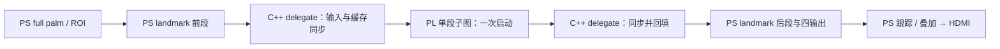

# PS 教师网络的 PL 局部加速方案

更新：2026-10-28。目标是在 PYNQ-Z2 上加速已经由 PS 执行的原版教师网络。
保留结构、权重、输入与全部输出，只将经过剖析选定的一小段计算交给 PL。
学生训练、蒸馏、扩数据复训、QAT 与学生 HLS 路线停止；本方案不以重新训练为前置条件。

当前进度：[P1 实测](../../project/analysis/teacher_partition_20261028/p1.md) 已完成 PS 后处理等价优化、两轮各 120 帧配对、100 个 ROI 的真实边界/独立 CPU 子图重放及 CMA 复制/缓存微基准。
优化后平均处理约 1.01 秒/帧（原版约 1.57 秒），全部网络输出和跟踪状态一致；这是 PS 优化，不是 PL 成绩。
下一步以相邻两个残差块作为一个连续分区做 CPU 测试接图，测 XNNPACK 拆分损耗，再决定是否综合。完整迁移净收益门禁仍待通过。
尚未实现新 delegate、构建浮点核或部署局部加速固件。
本文件是当前关键点加速的唯一执行方案；03 旧方案已清除正文并改为兼容入口。

## 1. 固定基线，不改变模型

| 项目 | 冻结内容 |
|---|---|
| 板卡 / 工具 | Zynq-7020 xc7z020clg400-1；Vivado/Vitis 2024.1；板端 ARMv7 Linux |
| PS 入口 | project/board/teacher_hands/run_teacher.py、teacher_geometry.py |
| 运行库 | 当前源码构建目标 TensorFlow Lite 2.12.1；记录板端实际 .so SHA、编译选项、线程数和执行计划 |
| Palm | 原版 palm_detection_full.tflite，输入 [1,192,192,3] FP32；首轮继续全部在 PS 执行 |
| Landmark | 原版 hand_landmark_full.tflite，输入 [1,224,224,3] FP32；首轮只选其中一个子图 |
| 输出 | 原有 63 坐标、presence、handedness、63 world 坐标四个张量全部保留；后处理和跟踪策略不变 |
| 输入与策略 | 固定视频/帧 SHA、原 ROI 仿射与归一化、阈值、检测/跟踪频率、线程数、显示与解码配置 |
| 数值 | FP32 输入、计算与输出；原模型存储的 FP16 常量按原语义展开为 FP32，不进行整数校准或 QAT |

两份本地模型 SHA 与图信息见 [模型证据](../../project/analysis/teacher_partition_20261028/README.md)。
部署前必须与板端重新核对；日期报告不代表当前在线板卡状态。
手部 full 模型不代表完整身体/双手 Holistic 已部署，旧 64 项整数协议和学生 65 项协议均不复用。

## 2. 接入方式：原图加一个 delegate 分区

采用 TFLite 自定义 delegate；原始 .tflite 不重建、不删头、不切成重新训练的网络。
delegate 只接管绑定模型 SHA 的白名单节点，其余计算留在 PS。
官方文档支持接管部分图，并指出多分区切换的数据复制可能抵消收益，故首轮限制为一个分区。
[接口依据：Google 自定义 delegate 文档](https://developers.google.com/edge/litert/performance/implementing_delegate)。
实现时按实际使用的 2.12.1 源码头文件核对 API，不为此升级运行库。

- 在 tflite_runner.cpp 创建解释器时接入；Python 每 ROI 仍只 invoke 一次整网，不逐层写寄存器。
- 采用 SimpleDelegateInterface 与 kernel 的初始化、准备、执行生命周期。白名单绑定节点/张量/形状/参数，不笼统接受所有 Conv。
- 初始化检查模型/固件 ABI，准备原权重与常驻缓冲；每次只传激活和结果，不重新分配或重传全部权重。
- 输出实际 execution_plan、替换节点与边界，证明其余节点由 PS 执行。核清常量 DEQUANTIZE 与所有外部依赖，不按编号范围盲切。
- 先做明确标记的 cpu_test delegate 验证分区接线与整网输出；它只是接口测试，不计 PL 成绩。
- pl 模式必须有真实核调用计数和执行时间。ABI 不匹配、超时或数值失败直接标记失败，不把 CPU 测试或回退混入 PL 数据。
- 超时后不假设 PL 已停止访存，不立即释放/复用缓冲；确认静止或受控恢复后才继续，禁止运行中重载 bit。

P0/P1 已确认当前 full 模型由 XNNPACK 接管；新 delegate 接入后仍需重新核对执行计划。
算子剖析可另建诊断解释器，但正式对照必须保留原有 CPU 优化和同等线程；不能通过关闭基线优化制造加速比。
记录 PL/CPU delegate 的应用顺序和剩余图融合变化，避免接入 PL 后破坏 CPU 性能。

## 3. 首轮具体候选

本地 full landmark 的 Conv/DW 总计 330,821,344 MAC/ROI，不含 FC、ADD 等其他算子，也不是耗时预测。
首轮剖析中后段一个残差块，利用较小边界，减少大中间激活跨 PS/PL 传输。

| 节点 ID（从 0 开始） | 原算子 | 激活形状 | 卷积 MAC |
|---|---|---|---:|
| 87 | 1×1 Conv + ReLU6 | 14×14×112 → 14×14×672 | 14,751,744 |
| 90 | 5×5 Depthwise + ReLU6 | 14×14×672 → 14×14×672 | 3,292,800 |
| 93 | 1×1 Conv，线性 | 14×14×672 → 14×14×112 | 14,751,744 |
| 94 | Add 残差 | 原输入 + 卷积结果 → 14×14×112 | 另计 21,952 次加法 |

入口 tensor 134、出口 tensor 138，均为 [1,14,14,112] FP32。残差复用同一个动态输入。
三层卷积均 stride=1、dilation=1、SAME；ADD 无激活、常量来源及静态外部依赖已冻结。
P1 已完成 100 个真实 ROI 的边界捕获和 CPU 子图逐值等价重放，PS 复制/缓存维护已测；PL 访存、核计算及接图开销仍待测。

- 动态输入/输出各 87,808 字节，合计 175,616 字节/ROI；不含 PS 复制、缓存同步及核内部 DDR 访问。
- tensor 135/136 各 526,848 字节；首版允许其在 PL 可访问的 DDR 内流转，不回 TFLite/PS，不宣称全片上流式。
- 该块 Conv/DW 共 32,796,288 MAC，占全图 Conv/DW 的 9.91%；这不是 CPU 耗时占比。
- FP32 权重/bias 约 675,136 字节，DDR 常驻并分块缓存，不假设全部放 BRAM。
- 若仅迁节点 93，动态边界约 614,656 字节；单层可用于核验证，但整链路优先考察完整小块。

单块保留为数值对照，不直接综合。P1 后处理优化后，单块理想平均整体收益约 4.3%，仍偏小。
当前接图候选改为原节点 87/90/93/94/97/100/103/104 的**相邻双块、一个连续分区**，入口 134、出口 142；没有扩大到全网。
其边界仍为 175,616B，参数 1,350,272B，Conv/DW 共 65,592,576 MAC；100 个 ROI 的独立重放与原边界逐值相同。
原图优化计时推断约 98.56ms/ROI，CMA 复制/缓存微基准约 1.386ms。按当前帧分布推算，总迁移成本约需低于 69ms/ROI 才有希望满足 P50 下降 5%。
这是预算而非 PL 成绩；先做 cpu_test 接图测 XNNPACK 拆分损耗，补齐净收益判断，再进入 HLS。
无净收益则停下报告，可在同一 full 图另选一个更划算的子图；首段验收前不扩大到全网。
Palm 首层和 ROI/缩放只作后续备选，不同时迁移；前处理迁到 PL 本身不会改善小手检出率。

## 4. 数据与硬件设计

选择 C++ delegate + 有界 FP32 计算核。旧 kp_layer 是 W12/A16 整数核，不能直接接 FP32 或复用其量化权重。

1. 一次分配 PL 可访问的连续输入、输出、scratch 与参数池，登记物理地址、长度和生命周期。
   具体 CMA/PYNQ 分配接口先在板端核实。普通 malloc 或 TFLite 虚拟地址不能写入 PL 地址寄存器。
2. 每次复制入口张量并 flush，提交带模型/分区 ABI 与序号的描述符，一次启动整个候选块。
   常量按原模型解码/展开并缓存，原 FP16→FP32 转换需对照，不能读取未执行 DEQUANTIZE 的空张量。
3. AXI-Lite 控制、AXI master 访问 DDR。首版复用算术阵列，在 PL 内按原顺序完成所选双块的六层卷积及两次残差加法，一次提交，不从 Python 逐层调用。
4. 完成后 invalidate 并回填 TFLite 出口；复制、同步、驱动、PL 和等待分别计时。HP 非一致性访问不能省略同步。
5. 首版不要求零复制。参数虽不每次经 Python 重传，核仍可能每 ROI 从 DDR 读取；这些访问及 scratch 读写全部纳入预算。
6. 固定 NHWC、原 Conv/DW 权重布局、padding、bias、ReLU6 与残差顺序；验证尾通道、行边界和越界哨兵。
7. 有界综合比较 4/8/16 个 FP32 MAC 通道，核对实际 II、累加依赖和 DSP/BRAM 后选并行度；100MHz 仅是初始目标。
   不按通道数×目标频率声称实测吞吐，也不预设浮点核必然快于 ARM/NEON。
8. 保持 FP32 语义；累加次序或融合改变需单独对照，不私自改为整数/FP16 算术，不靠放宽容差使失败通过。

新系统从与 PS 老师兼容的视频/音频基线隔离构建，不叠加旧 lite 整网核。
先检查资源与连接，再决定是否剥离闲置 KWS/传感器；不把去旧逻辑与首段数值问题混在首次验证中。
整板规划目标为 LUT/DSP/BRAM 各不超过 80%，预留视频与调试余量；超出先缩并行度并重算收益。
最终 routed WNS/WHS 非负、TNS/THS 为 0，无未解释的时钟、复位和端口问题。

## 5. 阶段交付

下表为阶段产物约定，已完成范围以 P0/P1 实测报告为准；后续程序仍待实现。构建缓存进 project/_tmp/，紧凑结果进 analysis。

| 阶段 | 交付 | 进入下一阶段条件 |
|---|---|---|
| P0 基线与剖析 | teacher_cpu_baseline.json、真实视频逐帧记录、输入 SHA、算子计时、执行计划与模型/库/固件 SHA | 输入/配置可复现；诊断计时与正式测速分开；热点对应清楚 |
| P1 单段冻结 | partition_manifest.json、全依赖/常量来源、黄金边界张量、传输微基准、CPU 子图耗时 | 子图独立复现，完整迁移开销预算有正收益 |
| P2 接图 | 版本匹配的 delegate/驱动 ABI、cpu_test 模式、节点替换与四输出对照 | 原图结构/输出/跟踪保持；严格一个分区，测试模式不冒充 PL |
| P3 核验证 | 独立 FP32 HLS、C/RTL、代表规模综合、并行度和描述符 | 数值通过，资源可容纳，预计整段净耗时小于 PS；否则停止 |
| P4 整板 | 隔离 BD、ABI/寄存器、实现报告、成对 bit/hwh 和 release manifest | 时序/资源及保留功能核对通过，再备份与冷部署 |
| P5 动态验收 | 实际核计数、分项耗时、全输出差异、动态视频/HDMI、同条件加速比 | 通过第 6 节门禁，才考虑第二段 |

建议实现位置：project/board/teacher_hands/pl_delegate/（C++ 接图/驱动），
project/algo/teacher_partition/（浮点核），project/scripts/keypoints/（剖析/对照）。
这些新增实现尚未建立；保留老师入口和旧核，不覆盖其他会话未提交的代码。

## 6. 验收与停止条件

### 数值与行为

- 至少 100 个真实 ROI/边界张量，覆盖普通、交叉、遮挡、快速运动与误检输入；作为等价性探针，不是训练集或通用精度测试集。
- 子图逐元素对照 CPU；最终四输出初始门禁 atol=1e-5、rtol=1e-4，报告各输出原单位的 max/P99 差异，NaN/Inf 或越限即排查。
  这是实施门禁而非已验证结果，不自动放宽。按同一 ROI 轨迹重放，有手/侧别阈值分支必须一致。
- 原图像坐标偏差 P99≤0.1 像素、最大≤0.5 像素作为显示门禁；再分别跑连续跟踪检查 ROI 漂移、重检出和有效结果数。
  缓存 ROI 对齐通过不能代替自主跟踪验收。

### 性能

- 固定同一 CPU 优化/线程、视频、帧数、检测策略与显示配置。预热后至少 3 轮配对，每轮至少 300 帧；单手/双手分开报告。
- T_PS 为原应用同口径总时间；T_hybrid 包含 PS 剩余工作、复制、同步、驱动、PL 与显示。实际加速比为 T_PS/T_hybrid。
- 先满足 T_CPU_block > T_copy+sync+driver+PL。建议首轮发布门禁：整体稳态 P50 下降至少 5%，P95 不劣化超过 5%，三轮方向一致；否则标为无明显净收益。
- 同时报有效结果数/秒、帧号和源帧到提交的帧龄。不能降检测频率、缩输入、跳第二只手或重复旧结果提高成绩。
- 正式测速关闭 profiler；另做至少 10 分钟连续运行，验证无越界、超时、缓冲泄漏和 HDMI 异常。未目视明确列为未验收。

用实测热点比例 f、局部加速 s 和额外开销占原总时间比例 e 估算：S=1/((1-f)+f/s+e)。
例如 f=20%、s=3、e=2%，总提速仅约 1.13 倍；这是演算示例，不是板端预测。
不把 MAC 占比当作 f，不预先承诺双手 20Hz。

### 部署

按候选 manifest 成对核验 bit/hwh/ABI，先记录现场状态并备份；冷启动加载一次，随后 download=False 接管。
保持 HDMI 时钟/复位/SOF，复验四象限颜色、动态画面、帧龄和保留音频功能。
边界不等价、核超时、资源/时序失败或全链路无净收益时，停止该候选，不转回学生训练。
